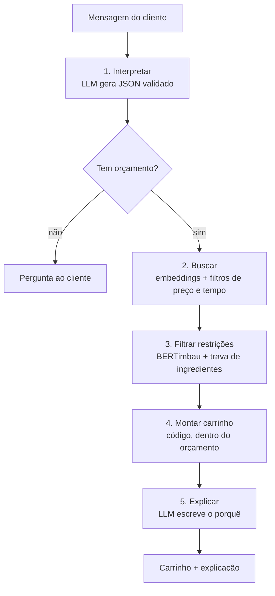

# Monta Meu Pedido

[](https://github.com/kesiasilv/monta-meu-pedido/actions/workflows/ci.yml)

Assistente de IA que monta pedidos de comida respeitando **orçamento, restrições alimentares e
tempo de entrega**, com um classificador alimentar próprio treinado e publicado no Hugging Face.

> **Cliente:** "Sou celíaca e intolerante a lactose, quero comida japonesa até 70 reais."
>
> **Assistente:** Montei no Haru Sushi & Cozinha Japonesa: Veggie Poke Bowl (R$ 46,00) + Chá
> Verde Sencha Gelado (R$ 11,00). Total R$ 64,90 (entrega R$ 7,90), chega em 40 min.
> Como não levam trigo nem laticínios, a refeição respeita suas restrições.

**Modelo:** [KesiaSilva/bertimbau-tags-pratos](https://huggingface.co/KesiaSilva/bertimbau-tags-pratos) ·
**Dataset:** [KesiaSilva/cardapios-delivery-ptbr](https://huggingface.co/datasets/KesiaSilva/cardapios-delivery-ptbr) ·
**Relatório técnico:** [RELATORIO.md](RELATORIO.md)

## Demonstração


A demo mostra o pedido, a conversa com o assistente, o carrinho montado e os bastidores: o que
o LLM entendeu e quanto tempo levou cada etapa. Para rodar na sua máquina, veja
[Como rodar](#como-rodar) (precisa de uma chave gratuita do Google AI Studio).

O código da demo também está publicado no
[Hugging Face Spaces](https://huggingface.co/spaces/KesiaSilva/monta-meu-pedido), mas o Space
fica pausado: a conta gratuita não tem cota de CPU para mantê-lo rodando.

## Resultados

**Classificadores no conjunto de teste** (7 tags, 44 pratos)

| Modelo | F1 macro | Latência por prato | Custo por uso |
|---|---|---|---|
| Baseline TF-IDF | 0,898 | 0,1 ms | não |
| **BERTimbau ajustado (este projeto)** | 0,884 | 34 ms (CPU) | não |
| Gemini zero-shot | 0,940 | 115 ms | sim |

**Workflow em 30 pedidos de teste**

| | Só o modelo | Modelo + trava de ingredientes |
|---|---|---|
| Restrições respeitadas | 70% | **100%** |
| Orçamento e tempo respeitados | 100% | 100% |
| Latência p50 | 3,1 s | 3,0 s |

O classificador sozinho deixou passar ovo, mel e trigo em 3 pedidos com restrição. Uma trava em
código, derivada das definições das tags, zerou as violações sem barrar nenhum prato correto.
A análise completa, com limitações, está no [relatório](RELATORIO.md).

## Como funciona

O código decide a ordem dos passos; o LLM só entende o pedido e escreve a explicação
([por quê](docs/adr/001-workflow-em-vez-de-agente.md)).



| Peça | Tecnologia | Código |
|---|---|---|
| Demo | Gradio no Hugging Face Spaces | `app.py` |
| API | FastAPI (`POST /pedido`, `GET /health`) | `src/mmp/api.py` |
| Workflow | Python, 5 passos testáveis | `src/mmp/pipeline/` |
| LLM | Gemini atrás da interface `LLMClient` (troca por `.env`) | `src/mmp/llm/` |
| Busca semântica | ChromaDB + `multilingual-e5-small` | `src/mmp/search.py` |
| Classificador | BERTimbau ajustado + baseline TF-IDF | `src/mmp/models/` |
| Avaliação | 3 classificadores + 30 pedidos com regras conhecidas | `evals/` |

## Decisões de engenharia

- **Regras críticas em código:** orçamento, tempo e restrições nunca dependem do LLM. Todos os
  números da resposta são gerados pelo código.
- **Provedor de LLM trocável:** o modelo foi trocado duas vezes durante a construção mudando
  só o `.env` ([ADR-003](docs/adr/003-gemini-atras-de-interface.md)).
- **Erros temporários e definitivos:** limite de requisições e falhas de rede são repetidos com
  espera crescente; chave ou modelo inválidos param na hora.
- **Protocolo de avaliação:** escolhas feitas na validação, teste usado só no fim.
- **Testes sem rede:** 62 testes com dublês do LLM, da busca e do classificador; a CI roda lint,
  testes e o build da imagem Docker.

Todas as decisões, com alternativas e consequências: [docs/adr/](docs/adr/).
Tudo o que deu errado e como foi resolvido: [docs/diario-de-bordo.md](docs/diario-de-bordo.md).

## Como rodar

Requer Python 3.12 e [uv](https://docs.astral.sh/uv/).

```bash
git clone https://github.com/kesiasilv/monta-meu-pedido.git
cd monta-meu-pedido
cp .env.example .env    # preencha GEMINI_API_KEY
make setup
make test
make demo               # http://localhost:7860
```

| Comando | O que faz |
|---|---|
| `make data` | Gera, valida e divide os dados (já incluídos no repositório) |
| `make baseline` | Treina o baseline TF-IDF |
| `make index` | Cria o índice de busca semântica |
| `make api` | Sobe a API em `http://localhost:8000/docs` |
| `make eval` | Roda o laboratório de avaliação |
| `make space` | Monta a pasta para publicar a demo no Hugging Face Spaces |

O fine-tuning roda no Google Colab: [notebooks/01_treino_bertimbau.ipynb](notebooks/01_treino_bertimbau.ipynb).

## Estrutura

```
src/mmp/
├── config.py · schemas.py · prompts.py · cardapio.py
├── data/       geração, validação, divisão e revisão dos dados
├── llm/        interface LLMClient, Gemini, Claude e dublê para testes
├── models/     baseline, BERTimbau, LLM zero-shot e métricas
├── search.py   busca semântica
├── pipeline/   os 5 passos, o orquestrador e a trava de ingredientes
└── api.py      FastAPI
evals/          casos de teste e resultados
docs/           design doc, ADRs e diário de bordo
```

## Limitações

Cardápios sintéticos (21 restaurantes, 291 pratos) com pistas explícitas nos nomes; conjuntos de
validação e teste pequenos; rótulos gerados por LLM e revisados por amostragem. **Não use para
alergias graves.** Detalhes na seção 7 do [relatório](RELATORIO.md).

## Como usei IA para construir

O projeto foi construído em um dia com o Claude Code como par de programação. O planejamento
começou por um design doc com objetivos, não-objetivos e métricas de sucesso; cada decisão foi
discutida antes de virar código. Rodei os experimentos, conferi os resultados e decidi entre as
alternativas. Vários problemas só apareceram ao testar com dados e APIs reais (modelo
indisponível, cota diária, um carrinho com sundae no lugar de poke, um teste que dependia do
`.env`), e cada um está registrado no diário de bordo com causa e solução.

## Licença

MIT
