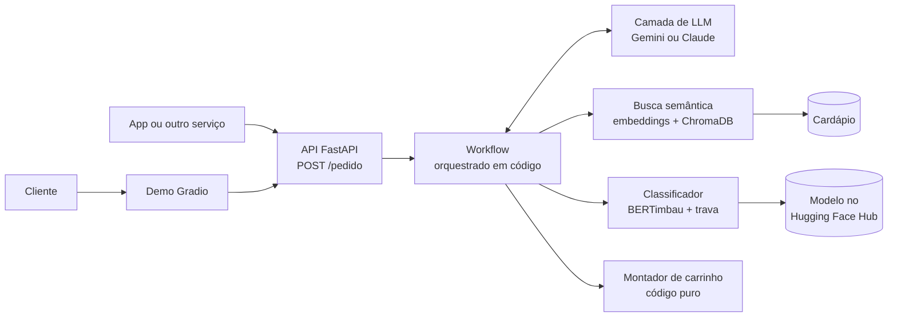
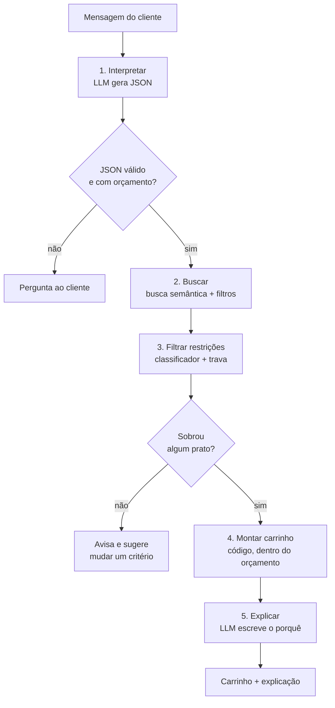
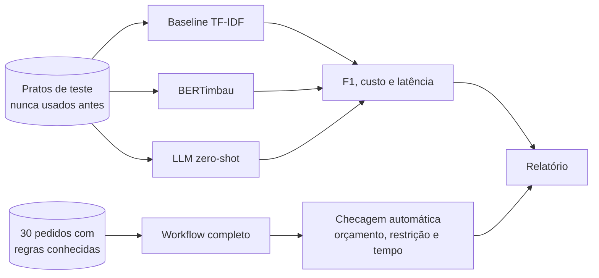

# Design doc: Monta Meu Pedido

Documento escrito antes da construção. Ele registra o problema, o escopo, a arquitetura e como
medir o resultado. O que mudou durante a construção está no [diário de bordo](diario-de-bordo.md)
e nos [ADRs](adr/).

## 1. Contexto e problema

Escolher comida em um app de delivery exige cruzar várias condições ao mesmo tempo: quanto
posso gastar, o que não posso comer, quanto tempo posso esperar e do que estou com vontade.

**Problema:** dado um pedido em linguagem natural, montar um carrinho de um único restaurante que
respeite orçamento, restrições alimentares e tempo de entrega, e explicar a escolha.

**Dificuldade técnica central:** saber se um prato atende a uma restrição exige entender a
descrição e os ingredientes. Um LLM faz isso bem, mas custa por chamada e é lento para muitos
pratos. Daí a pergunta de pesquisa: **um modelo pequeno ajustado substitui um LLM nessa tarefa?**

## 2. Objetivos e não-objetivos

**Objetivos**
1. Treinar e publicar um classificador multi-label de 7 tags alimentares em português.
2. Comparar com evidência três abordagens: baseline clássico, modelo ajustado e LLM zero-shot.
3. Integrar o modelo num workflow com LLM que monta pedidos respeitando regras críticas.
4. Entregar código com qualidade de produção: tipado, testado, com CI e reprodutível.
5. Documentar tudo e deixar uma demo.

**Não-objetivos**
- Usar dados reais de apps de delivery ou fazer scraping de cardápios.
- Login, pagamento ou histórico de usuário.
- Agente autônomo ou multiagente ([ADR-001](adr/001-workflow-em-vez-de-agente.md)).
- Automações (bot de mensagens, n8n) e dashboard analítico.
- Uso para alergias graves.
- Infraestrutura de escala (filas, Kubernetes).

## 3. Requisitos e metas

| ID | Requisito | Como verificar |
|---|---|---|
| RF1 | Aceitar pedido em texto livre em português | Teste da API |
| RF2 | Extrair orçamento, restrições, preferências e tempo máximo | Teste do passo 1 |
| RF3 | Perguntar quando faltar o orçamento | `status="precisa_info"` |
| RF4 | Carrinho de um restaurante: 1 principal + 0 ou 1 extra | Teste do montador |
| RF5 | Explicação que cita só itens do carrinho | Checagem no passo 5 |
| RF6 | Avisar quando nada servir | `status="sem_opcao"` |
| RNF1 | Orçamento nunca ultrapassado | 100% na avaliação |
| RNF2 | Resposta em menos de 8 s (p95) | Medido na avaliação |
| RNF3 | Reprodutível (seed e splits fixos) | `make eval` |
| RNF4 | Provedor de LLM trocável sem mudar o workflow | `LLM_PROVIDER` no `.env` |
| RNF5 | Custo zero para rodar | Planos gratuitos |
| RNF6 | Nenhuma chave no repositório | `.env` no `.gitignore` |

| Métrica | Meta inicial |
|---|---|
| F1 macro do BERTimbau no teste | ≥ 0,80 |
| Ganho sobre o baseline | ≥ +0,05 |
| Workflow respeita restrições | ≥ 95% |
| Workflow respeita orçamento e tempo | 100% |

## 4. Arquitetura do produto

Quais peças existem e como se conectam. As setas só apontam para dentro: nenhuma peça conhece
quem a chama, o que permite trocar a demo, o provedor de LLM ou o modelo sem mexer no resto.

| Peça | Responsabilidade | Código |
|---|---|---|
| Demo | Só a tela: chat, carrinho e bastidores | `app.py` |
| API | Valida a entrada e chama o workflow | `src/mmp/api.py` |
| Workflow | Executa os 5 passos na mesma ordem e trata os desvios | `src/mmp/pipeline/` |
| Camada de LLM | Interface única para qualquer provedor | `src/mmp/llm/` |
| Busca semântica | Pratos parecidos com o pedido, com filtros de preço e tempo | `src/mmp/search.py` |
| Classificador | Tags de cada prato | `src/mmp/models/` |
| Montador | Melhor combinação dentro do orçamento | `src/mmp/pipeline/steps.py` |

## 5. Workflow de um pedido

A ordem é fixa e decidida pelo código. O LLM entra em dois passos: entender e explicar.

| Passo | Quem faz | Proteção contra erro |
|---|---|---|
| 1. Interpretar | LLM | JSON validado pelo Pydantic; uma tentativa de correção; sem orçamento, o código pergunta |
| 2. Buscar | Código | Preço e tempo são filtros no banco, nunca decididos pelo LLM |
| 3. Filtrar | Modelo + regra | O prato precisa passar no classificador e na trava de ingredientes |
| 4. Montar | Código | Soma, taxa e tempo calculados em código |
| 5. Explicar | LLM | Recebe o carrinho fechado; se citar outro prato, entra uma explicação padrão |

**Restrição e preferência são diferentes:** `vegano`, `vegetariano`, `sem_lactose` e
`sem_gluten` eliminam pratos; `fit`, `picante` e `doce` só aumentam a pontuação.

## 6. Laboratório de avaliação

Não atende cliente: importa as mesmas peças do produto e mede.

**Regras do protocolo**
- Toda escolha (limiar, épocas, prompt) é feita na validação; o teste é usado só no fim.
- Os três classificadores recebem exatamente os mesmos pratos.
- As restrições do workflow são checadas contra os rótulos de referência, não contra o que o
  classificador previu.

## 7. Dados

Sintéticos, gerados por um LLM com as definições das tags no prompt, validados com Pydantic e
revisados por amostragem ([ADR-004](adr/004-dados-sinteticos.md),
[card do dataset](dataset_card.md)). Divisão 70/15/15 estratificada pelas tags, seed 42.

## 8. Padrões de engenharia

| Padrão | Regra |
|---|---|
| Python | 3.12 com `uv` |
| Tipagem | Type hints em funções públicas; dados entre módulos como modelos Pydantic |
| Configuração | Tudo que muda entre ambientes vem do `.env` via `config.py` |
| Estilo | `ruff` para lint e formatação |
| Testes | `pytest`, sem chamar APIs reais (dublês do LLM, da busca e do classificador) |
| Prompts | Centralizados em `prompts.py` |
| Logs | `logging`, com o tempo de cada passo |
| Commits | Conventional Commits (`feat:`, `fix:`, `docs:`, `chore:`) |
| CI | GitHub Actions: lint, testes e build da imagem Docker |
| Artefatos | Modelo no Hugging Face Hub, nunca no Git |

## 9. Segurança

| Risco | Proteção |
|---|---|
| Vazamento de chave | `.env` fora do Git; secrets no GitHub e no Spaces |
| LLM inventa prato ou preço | O LLM nunca escolhe pratos; números vêm do código |
| Prompt injection | Texto do cliente só como mensagem de usuário; saída forçada ao schema; regras em código |
| Entrada abusiva | Limite de 500 caracteres por pedido |
| Classificador erra uma restrição | Trava de ingredientes e aviso sobre alergias |
